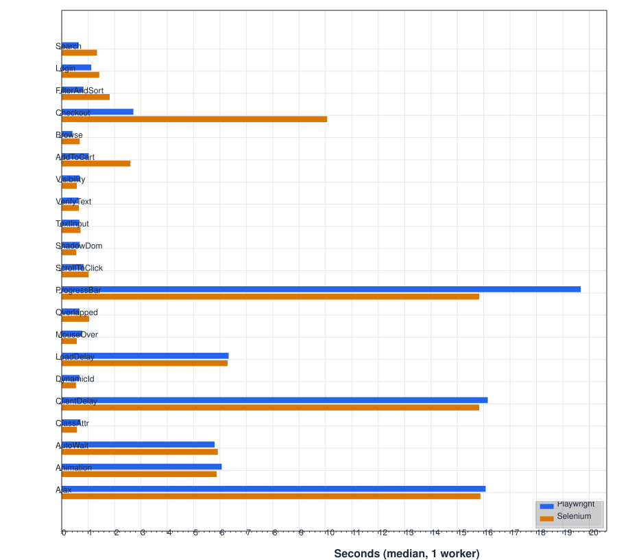

# Playwright vs Selenium (.NET)

A fair, reproducible comparison of [Playwright](https://playwright.dev/dotnet/) and [Selenium](https://www.selenium.dev/) in C#: the same 22 tests written idiomatically in each, run against two public demo sites, measured for speed, flakiness, parallel scaling and code size.

I kept hearing the same argument: Playwright is faster and less flaky, Selenium is the tried and tested standard. I wanted to see for myself, so I ran an experiment.

I wrote the same 22 tests twice in C#, once with [Playwright](https://playwright.dev/dotnet/) and once with [Selenium](https://www.selenium.dev/), each the way its own documentation recommends. Then I ran both suites against two public demo sites, many times over, and measured speed, flakiness, how well they scale in parallel, and how much code each one takes.

## Results

<!-- results:start -->
> **Preliminary.** These numbers come from two short smoke runs on my laptop (one measured round at 1 worker, one at 2), not the full 20-round benchmark. Treat them as a first impression, not a verdict. Full report: [docs/benchmark/2026-10-15-smoke](docs/benchmark/2026-10-15-smoke/report.md).

**Playwright needed 1.1× less total test time across 21 tests, both passed equally often, and Selenium used 9% less memory at 1 worker.**

_2026-10-15 · Apple M2 Pro · macOS 27.0.1 · Chrome for Testing 155.0.8059.79 · 1 round at 1/2 workers_

| | Playwright | Selenium | Better |
|---|---:|---:|---|
| Test time, sum of per-test medians (21 tests, 1 worker) | 83.2 s | 89.8 s | Playwright |
| Setup per test, median | 114 ms | 460 ms | Playwright |
| Browser launch, once per run | 553 ms | — | |
| Pass rate, every run | 100.0% | 100.0% | tie |
| Peak memory at 1 worker, median | 1502 MB | 1359 MB | Selenium |
| Lines of code, all tests | 177 | 181 | tie |

| Tool | Workers | Suite time | Peak memory | CPU (% of one core) |
|---|---:|---:|---:|---:|
| Playwright | 1 | 88.8 s | 1502 MB | 34% |
| Playwright | 2 | 57.3 s | 1949 MB | 48% |
| Selenium | 1 | 104.1 s | 1359 MB | 48% |
| Selenium | 2 | 53.2 s | 2423 MB | 87% |

<picture>
  <source media="(prefers-color-scheme: dark)" srcset="docs/benchmark/2026-10-15-smoke/charts/body-time.dark.svg">
  
</picture>
<!-- results:end -->

## What I tested

**Flakiness, on [UI Testing Playground](http://uitestingplayground.com).** This site is a collection of pages built to trip up test automation. I used 16 of them:

- content that shows up late: `ajax`, `clientdelay`, `loaddelay`
- selectors that change: `dynamicid`, `classattr`
- elements hidden behind other elements: `hiddenlayers`, `overlapped`, `scrolltoclick`
- elements that move or change: `animation`, `progressbar`, `visibility`, `autowait`
- DOM edge cases: `shadowdom`, `mouseover`, `textinput`, `verifytext`

**Real user journeys, on [Toolshop](https://practicesoftwaretesting.com).** Six everyday flows on an Angular web shop: browse, search, filter and sort, add to cart, log in, and check out up to the payment step. The tests never actually place an order.

The two test projects mirror each other file for file and test for test, so it's easy to compare them. For example, open `tests/Versus.Playwright.Tests/Flakiness/AjaxTests.cs` next to `tests/Versus.Selenium.Tests/Flakiness/AjaxTests.cs`.

## Side by side

Here are three of the tests, to give you a feel for how the two tools differ.

### `ajax`: waiting for content that arrives late

<table><tr><th>Playwright</th><th>Selenium</th></tr><tr><td>

```csharp
[Test]
public async Task LabelAppearsAfterAjaxRequest()
{
    await Page.GotoAsync($"{Settings.PlaygroundUrl}/ajax");
    await Page.Locator("#ajaxButton").ClickAsync();
    await Expect(Page.Locator("#content p.bg-success")).ToHaveTextAsync("Data loaded with AJAX get request.");
}
```

</td><td>

```csharp
[Test]
public async Task LabelAppearsAfterAjaxRequest()
{
    Driver.Navigate().GoToUrl($"{Settings.PlaygroundUrl}/ajax");
    Driver.FindElement(By.Id("ajaxButton")).Click();
    var label = Wait.Until(d => d.FindElement(By.CssSelector("#content p.bg-success")));
    await Assert.That(label.Text).ToBeEqualAsync("Data loaded with AJAX get request.");
}
```

</td></tr></table>

### `hiddenlayers`: an element covered by another

<table><tr><th>Playwright</th><th>Selenium</th></tr><tr><td>

```csharp
[Test]
public async Task GreenButtonCannotBeClickedTwice()
{
    await Page.GotoAsync($"{Settings.PlaygroundUrl}/hiddenlayers");
    var green = Page.Locator("#greenButton");

    await green.ClickAsync();
    await Expect(Page.Locator("#blueButton")).ToBeVisibleAsync();

    // A trial click runs every actionability check without clicking. Covered, it times out.
    // This 1-second window is why the test is left out of the speed figures.
    await Assert.That(() => green.ClickAsync(new() { Trial = true, Timeout = 1000 }))
        .ToThrowAsync<TimeoutException>();
    await Expect(Page.Locator("p.bg-warning")).ToHaveCountAsync(0);
}
```

</td><td>

```csharp
[Test]
public async Task GreenButtonCannotBeClickedTwice()
{
    Driver.Navigate().GoToUrl($"{Settings.PlaygroundUrl}/hiddenlayers");
    var green = Driver.FindElement(By.Id("greenButton"));

    green.Click();
    WaitForVisible(By.Id("blueButton"));

    await Assert.That(() => { green.Click(); return Task.CompletedTask; })
        .ToThrowAsync<ElementClickInterceptedException>();
    await Assert.That(Driver.FindElements(By.CssSelector("p.bg-warning"))).ToBeEmptyAsync();
}
```

</td></tr></table>

### `shadowdom`: reaching inside a shadow root

<table><tr><th>Playwright</th><th>Selenium</th></tr><tr><td>

```csharp
[Test]
public async Task GeneratedGuidHasTheRightFormat()
{
    await Page.GotoAsync($"{Settings.PlaygroundUrl}/shadowdom");

    // Playwright's CSS engine pierces open shadow roots.
    await Page.Locator("guid-generator #buttonGenerate").ClickAsync();
    await Expect(Page.Locator("guid-generator #editField"))
        .ToHaveValueAsync(new Regex("^[0-9a-f]{8}-[0-9a-f]{4}-[0-9a-f]{4}-[0-9a-f]{4}-[0-9a-f]{12}$"));
}
```

</td><td>

```csharp
[Test]
public async Task GeneratedGuidHasTheRightFormat()
{
    Driver.Navigate().GoToUrl($"{Settings.PlaygroundUrl}/shadowdom");

    // Only CSS selectors work inside a shadow root.
    var root = Wait.Until(d => d.FindElement(By.CssSelector("guid-generator")).GetShadowRoot());
    root.FindElement(By.CssSelector("#buttonGenerate")).Click();
    var value = root.FindElement(By.CssSelector("#editField")).GetDomProperty("value") ?? "";

    await Assert.That(value).ToMatchAsync("^[0-9a-f]{8}-[0-9a-f]{4}-[0-9a-f]{4}-[0-9a-f]{4}-[0-9a-f]{12}$");
}
```

</td></tr></table>

## What each tool gives you out of the box

| | Playwright | Selenium |
|---|---|---|
| Waiting for elements | Built in: [actionability checks](https://playwright.dev/dotnet/docs/actionability) before every action | You wait explicitly: [WebDriverWait](https://www.selenium.dev/documentation/webdriver/waits/) |
| Assertions that retry | Built in: [web-first assertions](https://playwright.dev/dotnet/docs/test-assertions) | No; you wait first, then assert |
| Network interception and mocking | Built in: [routes](https://playwright.dev/dotnet/docs/network) | Built in for Chromium-based browsers only, through DevTools: [CDP network features](https://www.selenium.dev/documentation/webdriver/bidi/cdp/network/). Cross-browser [BiDi network handlers](https://www.selenium.dev/documentation/webdriver/bidi/network/) are documented, but there's no C# example yet |
| Tracing | Built in: [trace viewer](https://playwright.dev/dotnet/docs/trace-viewer) | No |
| Video | Built in: [videos](https://playwright.dev/dotnet/docs/videos) | With an add-on: [Selenium Grid video recording](https://github.com/SeleniumHQ/docker-selenium#video-recording) (docker-selenium) |
| Multiple tabs | Built in: [pages](https://playwright.dev/dotnet/docs/pages) | Built in: [windows](https://www.selenium.dev/documentation/webdriver/interactions/windows/) |
| Iframes | Built in: [frame locators](https://playwright.dev/dotnet/docs/frames) | Built in: [switch to frame](https://www.selenium.dev/documentation/webdriver/interactions/frames/) |
| Shadow DOM | CSS selectors go straight through open roots: [locators](https://playwright.dev/dotnet/docs/locators) | `GetShadowRoot()`, and only CSS works inside: [finders](https://www.selenium.dev/documentation/webdriver/elements/finders/) |
| File upload | Built in: [upload files](https://playwright.dev/dotnet/docs/input#upload-files) | Built in: [file upload](https://www.selenium.dev/documentation/webdriver/elements/file_upload/) |
| WebDriver BiDi | No. It drives Chromium over the Chrome DevTools Protocol, with raw access through [`CDPSession`](https://playwright.dev/dotnet/docs/api/class-cdpsession) | Partly built in: [WebDriver BiDi](https://www.selenium.dev/documentation/webdriver/bidi/) (`UseWebSocketUrl = true`) |
| Mobile emulation | Built in: [emulation](https://playwright.dev/dotnet/docs/emulation) | Chromium-based browsers, through ChromeOptions (recommended on the [DevTools page](https://www.selenium.dev/documentation/webdriver/bidi/cdp/)) |
| Recording tests | Built in: [codegen](https://playwright.dev/dotnet/docs/codegen) | A separate tool: [Selenium IDE](https://www.selenium.dev/selenium-ide/) |
| Getting the browser | Built in: [`playwright install`](https://playwright.dev/dotnet/docs/browsers) | Built in: [Selenium Manager](https://www.selenium.dev/documentation/selenium_manager/) |
| Remote and grid runs | Connect to a remote browser server: [`BrowserType.ConnectAsync`](https://playwright.dev/dotnet/docs/api/class-browsertype) | Built in: [Selenium Grid](https://www.selenium.dev/documentation/grid/) |

## What I learned along the way

Writing both suites against live sites taught me a few things I didn't expect.

**1. A button that has stopped moving hasn't necessarily finished animating (Playwright).**
With a plain `ClickAsync`, the `animation` test failed 4 out of 4 runs in Playwright but passed in Selenium. Playwright checks that an element is visible, stable, enabled and able to receive events before it clicks. All of those checks passed while the button was spinning in place, so the click landed mid-animation, and then the page's `animationend` handler overwrote the status. I changed both tests to wait explicitly for the `spin` class to disappear: Playwright with `Expect(...).Not.ToHaveClassAsync`, Selenium with `WebDriverWait`. Now both tests know the same thing about the page.

**2. A faster tool exposes the app's own race conditions (Toolshop).**
Before I made the tests wait for the app's state, Playwright failed `Search` and `FilterAndSort` now and then (3 out of 8 runs), while Selenium never did. It turned out Toolshop simply shows whichever response arrives last. Playwright was quick enough to act before the first product list had loaded, and to sort before the filter response came back. Selenium's slower round trips just happened to give each request time to settle. Both tools now wait for the same app states: the initial product grid has loaded, and `filter_completed` has fired.

<details>
<summary>The two failure messages</summary>

`FilterAndSort`: `Locator expected to have text '[Thor Hammer, Claw Hammer, Hammer, Claw Hammer with Shock Reduction Grip, Sledgehammer, Court Hammer, Claw Hammer with Fiberglass Handle]' But was: '[Claw Hammer with Shock Reduction Grip, Hammer, Claw Hammer, Thor Hammer, Sledgehammer, Claw Hammer with Fiberglass Handle, Court Hammer]'` (7 elements, stable for 30 s).

`Search`: `Locator expected to have text '[Thor Hammer]' But was: '[Combination Pliers, Pliers, Bolt Cutters, Long Nose Pliers, Slip Joint Pliers, Claw Hammer with Shock Reduction Grip, Hammer, Claw Hammer, Thor Hammer]'` (9 elements).

</details>

**3. Scrolling the right element into view (`overlapped`).**
This page clears the input field if its centre ends up underneath another element. Scrolling the field itself into view wasn't enough in either tool. What worked in both was scrolling the *next* field (`#subject`) into view, which moves `#name` out from under the overlap.

**4. A toast in the way (Selenium).**
Right after the cart badge shows "1", the "added to cart" toast covers the centre of the cart link. I confirmed this once with `document.elementFromPoint` in both tools. Playwright's click is designed to wait until its target can actually be hit. WebDriver's click throws `ElementClickInterceptedException` instead. So in the Selenium checkout test I click through a `WebDriverWait` that ignores that exception, which is the closest WebDriver gets to what Playwright does on its own.

**5. The tools don't agree on what "visible" means.**
The `visibility` page made this obvious. Both tools agree that an element is hidden when it has been removed, or has `display: none`, `visibility: hidden` or zero width, so those are the only cases my test checks. Beyond that they differ. Playwright calls an element visible if it has a non-empty box, so an element with `opacity: 0`, one moved off screen, or one covered by another element all count as visible. Selenium says `opacity: 0` (and usually off screen) is *not* displayed, but a covered element *is*. Neither is wrong; it's just worth knowing which one you're using.

## How I made it fair

I tried hard to give neither tool an advantage. Here's what I did.

### Same browser, same window size

Both tools drive the same pinned [Chrome for Testing](https://googlechromelabs.github.io/chrome-for-testing/) binary, in new headless mode, with a 1280×720 viewport (`window.innerWidth`×`innerHeight`, which I measured in both). Each tool launches Chrome with its own default switches, the way its users get them. I only added what was needed:

- **Selenium:** `--headless=new`, `--window-size=1280,863` and `--disable-features=HttpsUpgrades,HttpsFirstBalancedModeAutoEnable`.
  - The window size sets the *outer* window. Headless Chrome keeps 143 px of browser UI, so 863 gives a 1280×720 viewport.
  - Without the `--disable-features` flag, Chrome 155 blocks the http-only Playground behind an HTTPS-First page.
- **Playwright:** nothing beyond its viewport option. Its defaults already include `--disable-features=…,HttpsUpgrades,…`, so the Playground loads fine. Adding a second `--disable-features` would actually wipe out that whole default list, because Chrome only keeps the last copy of a switch (I checked).

The defaults still differ in some notable ways:

- Playwright adds `--disable-field-trial-config`, `--disable-back-forward-cache`, `--disable-renderer-backgrounding`, `--disable-ipc-flooding-protection`, `--hide-scrollbars`, `--mute-audio`, `--no-sandbox` and `--force-color-profile=srgb`, and disables features including `PaintHolding`, `Translate`, `OptimizationHints` and `ThirdPartyStoragePartitioning`. It talks to Chrome over a pipe.
- Chromedriver adds `--enable-automation`, `--test-type=webdriver` and `--enable-logging=stderr`, and disables `IgnoreDuplicateNavs` and `Prewarm`. It talks to Chrome over a debugging port.

### Same rules for the tests

- **Isolation, each tool's own way.** Playwright gets one browser per run and a fresh context per test. Selenium gets a fresh driver session per test. I measure setup time separately from the test itself.
- **Same timeouts.** Every wait in both tools is 30 seconds. The slowest traps take 15–26 seconds on purpose.
- **No tricks.** Each tool waits the way its documentation recommends. No sleeps, no JavaScript clicks, no forced clicks, no hand-written retries. If the idiomatic approach fails, that failure is the result.
- **No retries, nothing thrown away.** Every failure counts. I only re-run a round when a site was already down before it started, and the report says how many times that happened.
- **Alternating order.** Odd rounds run Playwright first, even rounds run Selenium first, so if the network or a site has a bad moment, it hits both tools equally. I also throw away one warm-up round for each worker count.
- **Same test framework.** Both projects use only the runner from [Precept](https://github.com/autom3tion/precept) (`Precept.TestPlatform`), with no browser module, so the framework doesn't help either tool. In the interest of full disclosure: I also wrote Precept.

### How I read the numbers

- **Speed** comes from passed runs at 1 worker. **Pass rates** come from every run at every worker count. `hiddenlayers` counts towards pass rate but not speed, because Playwright's 1-second trial click is there by design.
- **Polling.** Each tool polls at its own default. `WebDriverWait` checks every 500 ms; Playwright retries actions and assertions at growing intervals, up to 1 s. So in either tool, a wait can finish up to one interval after the page is actually ready.
- **Failure types follow each tool's style.** A failed `Expect` in Playwright shows up as a timeout, because it keeps retrying until the time runs out. The same check in Selenium is made on a value I already have, so it fails as an assertion. Compare failure types within one tool, not across the two.
- **Lines of code.** For tests I count only the test method body (non-blank, non-comment lines, braces included). The "(fixture)" row counts whole files (`Fixtures/` and `Startup.cs`), including `using` lines, for each tool.
- **Memory and CPU** cover the whole process tree: .NET, Chrome, chromedriver and Playwright's Node driver.
  - Every 500 ms the bench adds up resident memory across the tree, and the memory figure is the peak of those per-run totals. Shared pages get counted once per process, so treat it as an upper bound.
  - CPU is also sampled every 500 ms, and when a process exits, the CPU it used since the last sample is lost. That isn't neutral: Selenium starts and quits a whole Chrome tree for every test, while Playwright keeps one browser for the whole run, so Selenium's CPU is under-reported compared with Playwright's. Very short-lived helper processes can be missed entirely.

### Limitations

- Each committed result comes from one machine. Your numbers will be different.
- The sites are hosted on the internet, so network noise is in every number. Medians and alternating order reduce it; running the sites locally removes it (see below).
- Chromium only.
- The exact versions I tested are in each result's `env.json`.

## Run it yourself

All you need is the [.NET 10 SDK](https://dotnet.microsoft.com/download).

```bash
dotnet run --project tools/Versus.Bench -- run
```

This downloads Chrome for Testing, builds both projects, and runs 20 rounds at 1, 2 and 4 workers. Expect it to take about 3–4 hours. When it's done, it writes `results/<date>-<machine>/` and updates the results section of this README.

Useful options: `--rounds`, `--workers`, and `--suite flakiness|journeys`. If you already have data, `report` rebuilds the report from `results/raw` without running anything.

To run just one project, use `dotnet test --project tests/Versus.Playwright.Tests`. The first time, install Playwright's browser with `pwsh tests/Versus.Playwright.Tests/bin/Debug/net10.0/playwright.ps1 install chromium`.

### Without network noise

Both sites can run on your own machine from their repositories: [UI Testing Playground](https://github.com/Inflectra/ui-test-automation-playground) and [Toolshop](https://github.com/testsmith-io/practice-software-testing) (Docker Compose). Point the benchmark at them, and you're also allowed more than 4 workers:

```bash
dotnet run --project tools/Versus.Bench -- run --playground-url http://localhost:<port> --toolshop-url http://localhost:<port> --allow-high-load --workers 1,2,4,8
```
