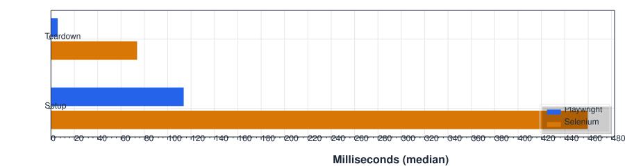

# Playwright vs Selenium — 2026-10-15, macbook-pro-sergejs

> **Preliminary smoke run.** This report covers one measured round at 1 worker and one at 2 workers (each after a discarded warm-up round), so medians and p95 are single samples. It is a first impression, not the full 20-round benchmark.
>
> The runs were recorded before the test projects were renamed from `Versus.<Tool>` to `Versus.<Tool>.Tests` and before a final round of test edits. To build this report with the current tooling, I rewrote the class names in a copy of the TRX files; timings are unchanged. Lines of code are counted from the current tests, so they don't exactly match the code that was timed.

**Playwright needed 1.1× less total test time across 21 tests, both passed equally often, and Selenium used 9% less memory at 1 worker.**

## Environment

- macOS 27.0.1; Apple M2 Pro, 12 cores; 16 GB RAM
- .NET 10.0.11, SDK 10.0.400; Chrome for Testing 155.0.8059.79
- Packages: Precept.TestPlatform 0.12.0, Precept.Core 0.12.0, Microsoft.Playwright 1.63.0, Selenium.WebDriver 4.51.0, Selenium.Support 4.51.0, ScottPlot 5.1.59, Microsoft.CodeAnalysis.CSharp 5.9.0, Microsoft.Extensions.TimeProvider.Testing 10.11.0
- Median latency: http://uitestingplayground.com/ 120 ms, https://practicesoftwaretesting.com/ 66 ms
- 1 measured round at 1, 2 workers; 0 rounds re-run because a site was down; 0 run crashes

## Summary

| | Playwright | Selenium | Better |
|---|---:|---:|---|
| Test time, sum of per-test medians (21 tests, 1 worker) | 83.2 s | 89.8 s | Playwright |
| Setup per test, median | 114 ms | 460 ms | Playwright |
| Browser launch, once per run | 553 ms | — | |
| Pass rate, every run | 100.0% | 100.0% | tie |
| Peak memory at 1 worker, median | 1502 MB | 1359 MB | Selenium |
| Lines of code, all tests | 177 | 181 | tie |

## Per test

| Test | Playwright median | p95 | pass | Selenium median | p95 | pass | Failures |
|---|---:|---:|---:|---:|---:|---:|---|
| Flakiness.AjaxTests.LabelAppearsAfterAjaxRequest | 16.1 s | 16.1 s | 100.0% | 15.9 s | 15.9 s | 100.0% |  |
| Flakiness.AnimationTests.MovingTargetIsClickedAfterAnimation | 6.1 s | 6.1 s | 100.0% | 5.9 s | 5.9 s | 100.0% |  |
| Flakiness.AutoWaitTests.ButtonIsClickedOnceItBecomesInteractable | 5.8 s | 5.8 s | 100.0% | 5.9 s | 5.9 s | 100.0% |  |
| Flakiness.ClassAttrTests.PrimaryButtonRaisesAlert | 713 ms | 713 ms | 100.0% | 580 ms | 580 ms | 100.0% |  |
| Flakiness.ClientDelayTests.LabelAppearsAfterClientSideDelay | 16.2 s | 16.2 s | 100.0% | 15.8 s | 15.8 s | 100.0% |  |
| Flakiness.DynamicIdTests.ButtonIsFoundWithoutItsId | 682 ms | 682 ms | 100.0% | 539 ms | 539 ms | 100.0% |  |
| Flakiness.HiddenLayersTests.GreenButtonCannotBeClickedTwice † | — | — | 100.0% | — | — | 100.0% |  |
| Flakiness.LoadDelayTests.ButtonAppearsAfterSlowPageLoad | 6.3 s | 6.3 s | 100.0% | 6.3 s | 6.3 s | 100.0% |  |
| Flakiness.MouseOverTests.ClickCountGoesUpOnEachClick | 783 ms | 783 ms | 100.0% | 573 ms | 573 ms | 100.0% |  |
| Flakiness.OverlappedTests.NameFieldAcceptsTextOnceScrolledIntoView | 674 ms | 674 ms | 100.0% | 1.0 s | 1.0 s | 100.0% |  |
| Flakiness.ProgressBarTests.StopsCloseToSeventyFivePercent | 19.7 s | 19.7 s | 100.0% | 15.8 s | 15.8 s | 100.0% |  |
| Flakiness.ScrollToClickTests.AllFourButtonsCanBeClicked | 831 ms | 831 ms | 100.0% | 1.0 s | 1.0 s | 100.0% |  |
| Flakiness.ShadowDomTests.GeneratedGuidHasTheRightFormat | 684 ms | 684 ms | 100.0% | 551 ms | 551 ms | 100.0% |  |
| Flakiness.TextInputTests.ButtonTakesTheTypedName | 670 ms | 670 ms | 100.0% | 714 ms | 714 ms | 100.0% |  |
| Flakiness.VerifyTextTests.WelcomeTextIgnoresExtraWhitespace | 631 ms | 631 ms | 100.0% | 650 ms | 650 ms | 100.0% |  |
| Flakiness.VisibilityTests.HiddenButtonsAreNotVisible | 681 ms | 681 ms | 100.0% | 574 ms | 574 ms | 100.0% |  |
| Journeys.AddToCartTests.CartBadgeCountsTheProduct | 1.0 s | 1.0 s | 100.0% | 2.6 s | 2.6 s | 100.0% |  |
| Journeys.BrowseTests.HomePageShowsProductGrid | 408 ms | 408 ms | 100.0% | 685 ms | 685 ms | 100.0% |  |
| Journeys.CheckoutTests.ReachesPaymentStepWithoutOrdering | 2.7 s | 2.7 s | 100.0% | 10.1 s | 10.1 s | 100.0% |  |
| Journeys.FilterAndSortTests.HammersSortedByPriceAscending | 823 ms | 823 ms | 100.0% | 1.8 s | 1.8 s | 100.0% |  |
| Journeys.LoginTests.DemoCustomerReachesAccountPage | 1.1 s | 1.1 s | 100.0% | 1.4 s | 1.4 s | 100.0% |  |
| Journeys.SearchTests.FindsProductByName | 641 ms | 641 ms | 100.0% | 1.3 s | 1.3 s | 100.0% |  |

† Left out of speed figures: Playwright's trial click waits 1 s on purpose, so its time measures the test's design, not the tool.

Speed figures use passed runs at 1 worker. Pass rates use every run at every worker count. A test that ran but left no timing record counts as a failed run of type `harness`; a run that crashed twice with no TRX is counted under run crashes and its tests are missing from that round.

## Parallel scaling

| Tool | Workers | Suite time (median) | Peak memory (median) | CPU (median, % of one core) |
|---|---:|---:|---:|---:|
| Playwright | 1 | 88.8 s | 1502 MB | 34% |
| Playwright | 2 | 57.3 s | 1949 MB | 48% |
| Selenium | 1 | 104.1 s | 1359 MB | 48% |
| Selenium | 2 | 53.2 s | 2423 MB | 87% |

## Lines of code

| Test | Playwright | Selenium |
|---|---:|---:|
| Flakiness.AjaxTests.LabelAppearsAfterAjaxRequest | 5 | 6 |
| Flakiness.AnimationTests.MovingTargetIsClickedAfterAnimation | 8 | 8 |
| Flakiness.AutoWaitTests.ButtonIsClickedOnceItBecomesInteractable | 9 | 9 |
| Flakiness.ClassAttrTests.PrimaryButtonRaisesAlert | 12 | 8 |
| Flakiness.ClientDelayTests.LabelAppearsAfterClientSideDelay | 5 | 6 |
| Flakiness.DynamicIdTests.ButtonIsFoundWithoutItsId | 4 | 4 |
| Flakiness.HiddenLayersTests.GreenButtonCannotBeClickedTwice | 9 | 9 |
| Flakiness.LoadDelayTests.ButtonAppearsAfterSlowPageLoad | 6 | 6 |
| Flakiness.MouseOverTests.ClickCountGoesUpOnEachClick | 7 | 6 |
| Flakiness.OverlappedTests.NameFieldAcceptsTextOnceScrolledIntoView | 7 | 7 |
| Flakiness.ProgressBarTests.StopsCloseToSeventyFivePercent | 9 | 10 |
| Flakiness.ScrollToClickTests.AllFourButtonsCanBeClicked | 9 | 9 |
| Flakiness.ShadowDomTests.GeneratedGuidHasTheRightFormat | 6 | 7 |
| Flakiness.TextInputTests.ButtonTakesTheTypedName | 6 | 6 |
| Flakiness.VerifyTextTests.WelcomeTextIgnoresExtraWhitespace | 4 | 5 |
| Flakiness.VisibilityTests.HiddenButtonsAreNotVisible | 8 | 8 |
| Journeys.AddToCartTests.CartBadgeCountsTheProduct | 11 | 11 |
| Journeys.BrowseTests.HomePageShowsProductGrid | 4 | 4 |
| Journeys.CheckoutTests.ReachesPaymentStepWithoutOrdering | 24 | 28 |
| Journeys.FilterAndSortTests.HammersSortedByPriceAscending | 8 | 8 |
| Journeys.LoginTests.DemoCustomerReachesAccountPage | 8 | 8 |
| Journeys.SearchTests.FindsProductByName | 8 | 8 |
| (fixture) | 96 | 81 |

## Charts

<picture>
  <source media="(prefers-color-scheme: dark)" srcset="charts/body-time.dark.svg">
  
</picture>

<picture>
  <source media="(prefers-color-scheme: dark)" srcset="charts/setup-time.dark.svg">
  
</picture>

<picture>
  <source media="(prefers-color-scheme: dark)" srcset="charts/suite-time.dark.svg">
  
</picture>

<picture>
  <source media="(prefers-color-scheme: dark)" srcset="charts/memory.dark.svg">
  
</picture>

